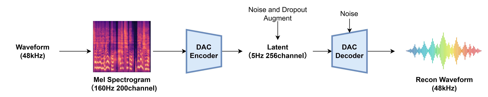
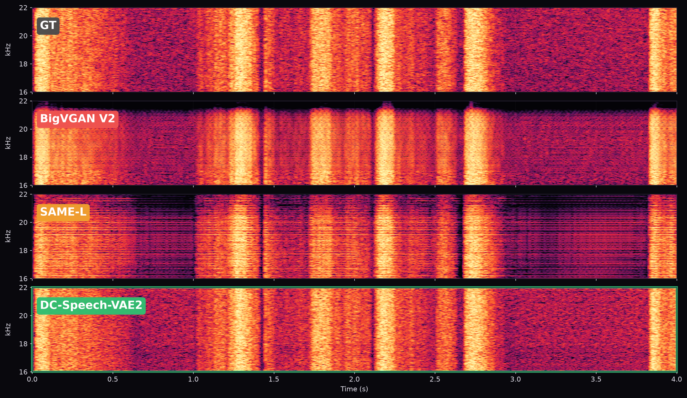

# DC-Speech-VAE2-Inference

[](https://github.com/KdaiP/DC-Speech-VAE2-Inference)
[](https://huggingface.co/KdaiP/DC-Speech-VAE2/tree/main/2_0)

**DC-Speech-VAE2** is an upgraded version of [DC-Speech-VAE](https://github.com/KdaiP/DC-Speech-VAE).
It compresses **48 kHz** audio into a **5 Hz** **256 channels** latent representation. We hope this VAE can provide a high-sample-rate, ultra-low-frame-rate speech VAE for the development of high-fidelity speech generation models.

DC-Speech-VAE2 learns a latent representation that is sparse and robost to noise. It is easy to model for downstream diffusion/flow-matching based generative tasks(such as F5-like TTS models and Continuous Autoregressive Speech Models). Compared with DC-Speech-VAE, it achieves approximately a **30% reduction in downstream flow-matching loss**.

## Overview
<p align="center">
  
  <br>
  <em></em>
</p>

DC-Speech-VAE2 adopts the architecture of [DAC](https://github.com/descriptinc/descript-audio-codec) for end-to-end training and inference. The model takes high-quality mel spectrogram as input and directly reconstructs the waveform.

Unlike [DC-Speech-VAE](https://github.com/KdaiP/DC-Speech-VAE), DC-Speech-VAE2 does not require an additional mel vocoder such as [BigVGAN](https://github.com/NVIDIA/BigVGAN).

## Evaluation results

We compare DC-Speech-VAE2 with [BigVGAN V2](https://github.com/NVIDIA/BigVGAN) and [SAME-L](https://huggingface.co/stabilityai/SAME-L), the [Stable Audio 3](https://github.com/Stability-AI/stable-audio-3) VAE.

Inference results for all three models are available here: [🤗 Download examples 🤗](https://huggingface.co/KdaiP/DC-Speech-VAE2/blob/main/2_0/subjective_eval_audio.zip).

We recommend listening to the audio samples to compare the perceptual quality of each model.

| Model | Sample Rate | Frame Rate | Channels | Encoder Params | Decoder Params | PESQ ↑ | MSTFT ↓ | Encoder RTF | Decoder RTF |
|---|---:|---:|---:|---:|---:|---:|---:|---:|---:|
| BigVGAN V2 | 44.1 kHz | 86.133 Hz | **128** | N/A | 122.185M | **4.0134** | **0.9440** | N/A | 0.14996 |
| SAME-L | 44.1 kHz | 10.767 Hz | 256 | 426.064M | 426.063M | 2.8292 | 1.1213 | 0.10363 | 0.10191 |
| **DC-Speech-VAE2** | **48 kHz** | **5.000 Hz** | 256 | **181.590M** | 157.816M | 2.8735 | 0.9713 | **0.00374** | **0.06266** |

RTF is measured on an RTX 5060.

<p align="center">
  
  <br>
  <em></em>
</p>

BigVGAN V2 and SAME-L show periodic high-frequency artifacts; DC-Speech-VAE2 is visually cleaner.

## Quick start

### 1. Download pretrained model

Download the [🤗 pretrained checkpoint 🤗](https://huggingface.co/KdaiP/DC-Speech-VAE2/blob/main/2_0/checkpoint.pt) and place it at:

```bash
./pretrained/checkpoint.pt
```

### 2. Install dependencies

The only required dependencies are **PyTorch** and **torchaudio**.

Please follow the official PyTorch installation guide for your platform and hardware:

<https://pytorch.org/get-started/locally>

### 3. Inference

Reconstruct example:

``` python
import torch
import torchaudio

from dc_speech_vae.wrapper import VAEInferenceWrapper

device = torch.device('cuda' if torch.cuda.is_available() else 'cpu')
model = VAEInferenceWrapper('./pretrained/checkpoint.pt').to(device)

audio_input_path = 'test.wav'
audio_output_path = 'reconstructed.wav'

audio, sample_rate = torchaudio.load(audio_input_path)

reconstructed_audio = model.reconstruct(audio, sample_rate)[0]
torchaudio.save(audio_output_path, reconstructed_audio.cpu(), model.sample_rate)
print(f"Reconstructed audio saved to {audio_output_path} at sample rate {model.sample_rate}.")
```

Encode and decode example:

```python
audio = audio.to(device)
if sample_rate != model.sample_rate:
    audio = torchaudio.functional.resample(audio, sample_rate, model.sample_rate)
with torch.inference_mode():
    latent = model.encode(audio)
    decoded_audio = model.decode(latent)
```

## Reference

This project builds on ideas and components from the following works and repositories:

- [HiFi-GAN](https://github.com/jik876/hifi-gan)
- [BigVGAN](https://github.com/NVIDIA/BigVGAN)
- [DAC](https://github.com/descriptinc/descript-audio-codec)
- [HiFi-VAE-GAN](https://github.com/OpenNSP/Hifi-vaegan)
- [RefineGAN](https://arxiv.org/abs/2111.00962)

## Spetial Thanks

- [zhiyongchenGREAT](https://github.com/zhiyongchenGREAT)
- [aizhiqi-work](https://github.com/aizhiqi-work)
- [ylzz1997](https://github.com/ylzz1997)
- [CNChTu](https://github.com/CNChTu)
